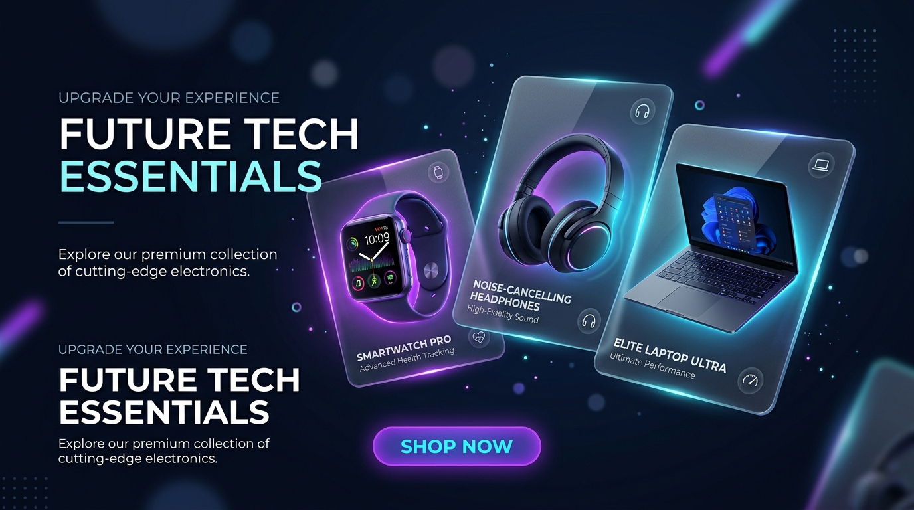

# CodeAlpha_EcommerceStore

> **CodeAlpha Full Stack Development Internship — Task 1**

## 🛒 NexStore — Premium Tech E-Commerce Store

A fully responsive, feature-rich e-commerce web application built with **HTML, CSS, and JavaScript** as part of the CodeAlpha internship program.

---

## 🌟 Live Preview

Open `index.html` directly in your browser — no server setup needed!

---

## ✨ Features

| Feature | Description |
|---------|-------------|
| 🛍️ Product Listings | 12 premium tech products across 5 categories |
| 🔍 Search & Filter | Live search, category filters, and sort options |
| 🛒 Shopping Cart | Slide-out cart with quantity controls and subtotal |
| ❤️ Wishlist | Add/remove products with persistent localStorage |
| 👤 User Auth | Login & Sign Up modal (localStorage-based) |
| 📦 Checkout | Full shipping + payment form with order confirmation |
| ⚡ Flash Sale | Live countdown timer for deals section |
| 🔔 Toast Alerts | Animated feedback notifications |
| 📱 Responsive | Fully mobile & tablet friendly |

---

## 🗂️ Project Structure

```
CodeAlpha_EcommerceStore/
├── index.html        # Main HTML structure
├── style.css         # Premium dark-theme styles
├── app.js            # All interactivity & logic
└── hero-banner.jpg   # AI-generated hero image
```

---

## 🎨 Tech Stack

- **Frontend:** HTML5, CSS3 (Vanilla), JavaScript (ES6+)
- **Fonts:** Google Fonts — Inter & Outfit
- **Storage:** localStorage (cart, wishlist, user session)
- **No frameworks, no dependencies** — pure vanilla code

---

## 📸 Screenshots

### Hero Section


---

## 🚀 How to Run

1. Clone the repository:
   ```bash
   git clone https://github.com/adiityan/CodeAlpha_EcommerceStore.git
   ```
2. Navigate to the folder:
   ```bash
   cd CodeAlpha_EcommerceStore
   ```
3. Open `index.html` in your browser — done! ✅

---

## 🔑 Key Functionality

- **Add to Cart** — Click "Add to Cart" on any product or use Quick View modal
- **Cart Management** — Adjust quantities, remove items, view totals
- **Checkout Flow** — Fill shipping + card details, get order confirmation
- **User Login/Signup** — Register or sign in via the user icon (top-right)
- **Search** — Type in the search bar to filter products instantly
- **Category Filter** — Click tabs (Audio, Wearables, Laptops, Phones, Gaming)
- **Wishlist** — Click the heart icon to save favorite products

---

## 👨‍💻 Author

**Adithyan KV**
- GitHub: [@adiityan](https://github.com/adiityan)
- Email: iadithyankv@gmail.com

---

## 🏢 Internship

Built as **Task 1** for the [CodeAlpha](https://codealpha.tech) Full Stack Development Internship.

> ⭐ If you found this useful, please consider starring the repository!
